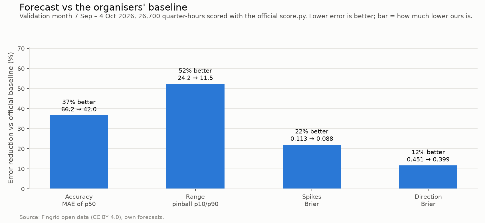
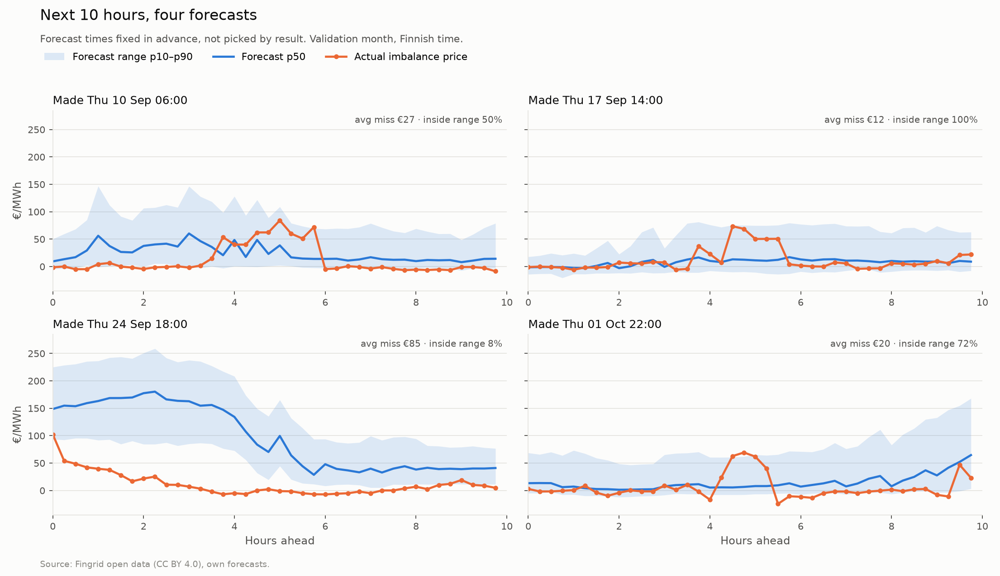
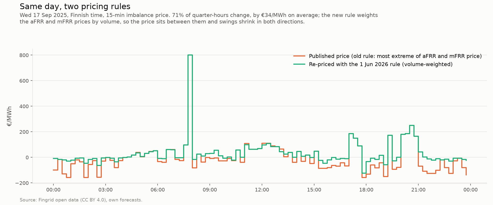
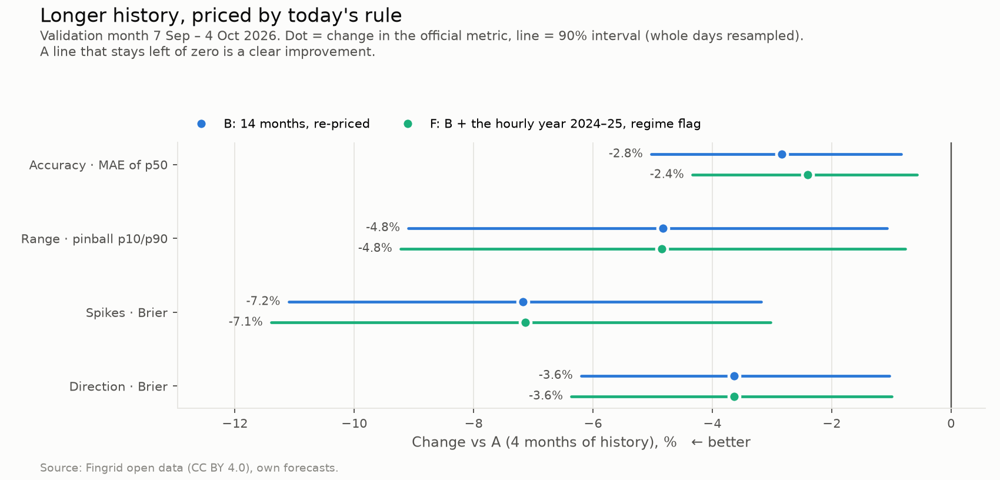
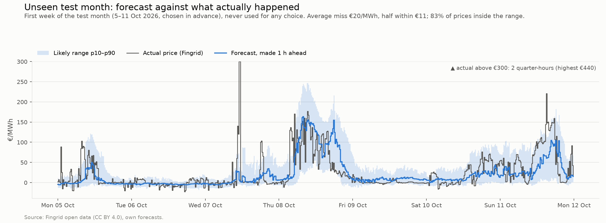

# Forecasting the Finnish imbalance price after the 1 June 2026 rule change

## In one paragraph

At the Since AI 2026 hackathon (Turku Energia challenge) we built a model that forecasts the Finnish
imbalance price for the next 10 hours in 15-minute steps, with a range (p10–p90), the direction of
balancing and the probability of price spikes. On the validation month it cut the organisers'
baseline error by 35% (accuracy) to 49% (range). After the event I tackled the model's main
limitation: Fingrid changed how the imbalance price is calculated on 1 June 2026, so the model could
only learn from four months of data. I implemented both of Fingrid's pricing rules, reproduced
Fingrid's published price to within one cent in 99.6% of quarter-hours and re-priced 14 months of
history under the new rule. Trained on that longer, consistent history, the forecast improved on all
four official metrics (2.8% to 7.2%, each a clear difference). On the unseen test month, an hour ahead,
half of all quarter-hours land within €10/MWh of Fingrid's actual price, 86% inside the predicted range,
and 78% of price spikes are flagged in advance.

## 1. The task

| | |
|---|---|
| Target | Finnish imbalance price (Fingrid dataset 319), €/MWh |
| Horizon | 40 quarter-hours (10 h) from each hourly forecast time |
| Outputs | p10, p50, p90; probability of up / down / no regulation; probability of a high or low spike (more than €50 from the spot price) |
| Rule | at each forecast time only data already published may be used (`first_usable_origin_utc`) |
| Scoring | MAE of p50; pinball loss of p10/p90; Brier score for spikes and direction (official `score.py`) |

Our submission (*combined v3*): 8 tuned models (XGBoost, LightGBM, CatBoost, a quantile forest, the
TimesFM foundation model, SARIMAX, a climatology and the official baseline), blended with separate weights for each step ahead, then the range is
re-calibrated on recent errors. It was frozen before the test period was scored
(`SUBMISSION_FREEZE.md`).



| Validation month, 7 Sep – 4 Oct 2026 | Official baseline | Hackathon submission | After the hackathon (variant B) | B vs baseline |
|---|---|---|---|---|
| MAE of p50 (€/MWh) | 66.20 | 43.32 | **41.97** | −37% |
| Mean pinball loss p10/p90 | 24.18 | 12.21 | **11.55** | −52% |
| p10–p90 coverage (target 0.80) | 0.68 | 0.79 | 0.76 | |
| Brier, spikes | 0.113 | 0.094 | **0.088** | −22% |
| Brier, direction | 0.451 | 0.410 | **0.399** | −12% |

The chart and the forecasts below are variant B (section 4): three tuned models, trained on the
re-priced history.



## 2. The problem: the price rule changed

Until 31 May 2026 the imbalance price was the **more extreme** of two balancing prices (aFRR and
mFRR) in the dominating direction. From 1 June 2026 Fingrid **weights the two prices by their
volumes**. Spikes therefore look different before and after the change. The hackathon data started
on 31 May 2026, so the model only had about four months to learn from, and simply adding older data
would teach it spikes that no longer happen the same way.



## 3. What I did after the hackathon

**Licence clean-up.** The hackathon's Nord Pool spot file was licensed for the event only. I replaced
it with the ENTSO-E day-ahead price, fetched at run time and never stored in git, and confirmed the
frozen model gives identical scores with it. Only Fingrid open data (CC BY 4.0) and our own forecasts
appear in published figures.

**Longer history.** Fetched the Fingrid inputs back to June 2024, with the same availability rule
(each value is usable only after its publication delay) and tests that check no future data leaks
into a forecast.

**Both pricing rules, checked against Fingrid.** Implemented the old and new rules from Fingrid's
documents and tested which input datasets reproduce the published price:

| Period | Rule | Quarter-hours within €0.01 of Fingrid's price |
|---|---|---|
| from 1 Jun 2026 | new, volume-weighted | **99.55%** |
| 19 Mar 2025 – 31 May 2026 | old, 15-min prices | **99.85%** |
| 12 Jun 2024 – 18 Mar 2025 | old, hourly prices | 99.85% |
| no dominating direction | day-ahead price | 100% |

Every mismatch is explained: Fingrid's own corrections (e.g. 23 Oct 2025, PICASSO price errors),
inputs revised after publication, and mFRR direct activations, where Fingrid publishes the maximum
power instead of the energy, so the weight cannot be known exactly. For those I keep the published
price rather than guess.

**Re-priced history.** Applied the new rule to 19 Mar 2025 – 31 May 2026. 62% of quarter-hours
change, by €10/MWh on average; the price stays between the two component prices, so swings shrink in
both directions. Share of quarter-hours that count as spikes: high 17.8% → 15.6%, low 21.7% → 17.4%.

## 4. The experiment

Each variant changes only the training history; features, models (the three fastest members) and
tuning budget (40 trials per model on the same four time-ordered folds) stay the same. Nothing is
tuned on the validation or test months. Variants are compared on exactly the same quarter-hours,
with a 90% confidence interval from a bootstrap that resamples whole days, so a single unusual day
cannot decide the result.

| Variant | Training history | Price labels |
|---|---|---|
| A (reference) | from 1 Jun 2026 | published |
| B | from 19 Mar 2025 | re-priced to the new rule |
| F | from 12 Jun 2024 | B's re-priced history plus the hourly-price year 2024–25 as published (too coarse to re-price), with a flag for the old regime |

| Validation month | A | B | F |
|---|---|---|---|
| MAE of p50 | 43.19 | **41.97** (−2.8%) | 42.15 (−2.4%) |
| Mean pinball p10/p90 | 12.13 | 11.55 (−4.8%) | **11.55** (−4.8%) |
| Coverage p10–p90 (target 0.80) | 0.78 | 0.76 | 0.77 |
| Brier, spikes | 0.095 | **0.088** (−7.2%) | 0.088 (−7.1%) |
| Brier, direction | 0.414 | **0.399** (−3.6%) | 0.399 (−3.6%) |



**What it means.**

- **A longer history priced by today's rule helps.** B and F beat A on all four official metrics,
  and every 90% interval stays below zero: the gain is not one lucky day. It holds at every forecast
  hour from 1 to 10 and is largest in the first hour (average miss €39.7 against €41.7; direction
  0.369 against 0.397).
- **The extra hourly year adds nothing.** F is level with B on every metric. Prices before March 2025
  were hourly and cannot be re-priced, so that year brings volume but not the right price behaviour.
  B is the simpler model at the same accuracy, so B is the choice.
- **Honest limits.** On the earlier rolling folds (12 Jul – 6 Sep) the differences to A are smaller
  and not clear, and the validation result is one month. The right summary is "consistently better,
  by about 3–7%", not a guaranteed gain everywhere. B's range is slightly narrower than it should be
  (76% of prices inside a range meant to hold 80%).
- **Even with three models** B beats the frozen eight-model hackathon submission on every metric.

### Against what actually happened: the unseen test month

The test month (5 Oct – 1 Nov 2026) was never used for any choice: B was picked on the training folds
and the validation month first. Scored afterwards against Fingrid's published prices:

| Test month, official scorer | Official baseline | Hackathon submission (8 models) | **B (3 models)** |
|---|---|---|---|
| MAE of p50 (€/MWh) | 42.28 | 27.37 | **26.18** |
| Mean pinball loss p10/p90 | 15.21 | 7.13 | **6.76** |
| Brier, spikes | 0.0688 | 0.0595 | **0.0550** |
| Brier, direction | 0.4253 | 0.4007 | **0.3950** |
| p10–p90 coverage (target 0.80) | 0.80 | 0.90 | 0.85 |

In plain terms, for the forecast made one hour ahead:

- half of all quarter-hours land within **€10/MWh** of the actual price, 69% within €20 (prices swung
  with a standard deviation of €70);
- **86%** of actual prices fall inside the predicted range (aim 80%);
- the direction of regulation (up, down or none) is right **74%** of the time;
- **78%** of price spikes (more than €50 from the day-ahead price) are flagged an hour in advance, with
  false alarms in 13% of quarter-hours.

Over the full 10-hour horizon: 85% inside the range, direction right 71%, 63% of spikes flagged.



## 5. From forecast to operator tool

The forecasts feed a dashboard with two linked views: **[docs/dashboard.html](docs/dashboard.html)** (download and open
in a browser; one self-contained file, built with `python -m imbalance control-room --share`):

- **Overview: does the forecast work?** The whole validation month on one chart (actual price,
  best guess and likely range), zoom to a week or a day, forecasts made 1, 2, 4 or 10 hours ahead,
  scores per model for the period shown, accuracy by forecast hour and a day-by-day comparison with A.
  Over the month B misses by €40.4 on average one hour ahead, against €42.3 for A; it is better than A
  at every horizon from 1 to 10 hours and on 16 of 27 days.
- **Control room: what should I do in the next hours?** Designed for a trader on shift: the last
  6 and next 10 hours around "now", regulation direction and spike risk, alerts with an "act by" time
  before the intraday gate closes, an exposure panel that turns an expected imbalance (MWh) into
  euros, and a live simulation that replays any day quarter-hour by quarter-hour, with a running
  scorecard against A.

Clicking the Overview chart opens that hour in the control room; the control room's time (also
during a simulation) is marked on the Overview. The published version uses a synthetic spot price
built from Fingrid's public data; spikes and every score are still judged against the real
day-ahead price. Parts of the design without a data source in this project (real-time grid balance,
driver explanations) are labelled as such rather than filled with invented values.

## 6. Limits and next steps

- mFRR direct-activation quarter-hours cannot be re-priced exactly (Fingrid publishes maximum power,
  not energy); they keep the published price.
- The validation month is one month; the bootstrap intervals show how much that limits the
  conclusions. On single days B can do worse than A (8 Sep: three low-price spikes missed).
- B and F were first built with the quantile forest's settings from A: a full search on the long
  histories ran the 30 GB machine out of memory (the forest stores every training value in its
  leaves). A memory-safe search (larger leaves; at most 128 stored values per leaf for F) found
  settings about 0.5% better for B's quantile forest alone; B rebuilt with them is compared with the
  results above. F was not taken further: it matched B, so the extra hourly year is not worth its cost.
- Next: score the chosen variant on the held-out test month (5 Oct – 1 Nov 2026), and explain the
  drivers of each alarm.

## Repository

| Path | What it is |
|---|---|
| `imbalance/pricing.py`, `imbalance/reprice.py` | Fingrid's old and new imbalance price rules, the reproduction of the published price and the re-priced history |
| `imbalance/features.py`, `cv.py`, `tune.py`, `models/`, `combine.py`, `blend.py` | features (only data published before each forecast time), time-ordered folds, Optuna tuning, the models and the per-step blend with range calibration |
| `imbalance/variants.py`, `scripts/run_variant.sh` | the history experiments (A, B, F) and the day-block bootstrap comparison |
| `imbalance/control_room.py`, `imbalance/web/control_room.html`, `imbalance/synthetic_spot.py` | the dashboard and the synthetic spot price of its shareable version |
| `scripts/portfolio_figures.py` | the figures in `docs/img/` |
| `tests/` | data availability rule and leakage, metrics identical to the official scorer, price rules |
| `config/` | tuned settings and alarm levels per variant |
| `patches/build_dataset_extended.patch` | my extension of the organisers' data builder: the extended Fingrid history and the ENTSO-E day-ahead price |

### Running it

The original inputs come from the challenge's starter package, which is not redistributed here
(`build_dataset.py`, `availability.csv`, `score.py` and the data). With the package in the repository root:

```bash
python3.14 -m venv .venv && .venv/bin/pip install -r requirements-lock.txt
patch build_dataset.py patches/build_dataset_extended.patch
# .env (git-ignored): FINGRID_API_KEY=... and ENTSOE_API_TOKEN=... (your own keys)
.venv/bin/python build_dataset.py --catalogue extended          # Fingrid history into data_ext/
.venv/bin/python -m imbalance reprice --v2                       # re-priced imbalance price
scripts/run_variant.sh B                                        # tune, fit, blend, score one variant
.venv/bin/python -m imbalance variants compare B F               # bootstrap comparison with A
.venv/bin/python -m imbalance control-room --share               # dashboard
```

No data, keys or real-spot dashboards are committed: `data/`, `data_ext/`, `runs/` and `.env` are git-ignored.

## Credits

The hackathon model (features, training, tuning and the eight-model blend) and all post-hackathon
work described here are my own. The hackathon team's dashboard, final report and presentation were
made by teammates and are not part of this write-up.

*Data: Fingrid open data, CC BY 4.0. Day-ahead prices from ENTSO-E are used at run time only and are
not redistributed.*
